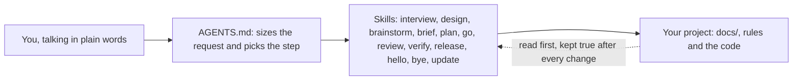
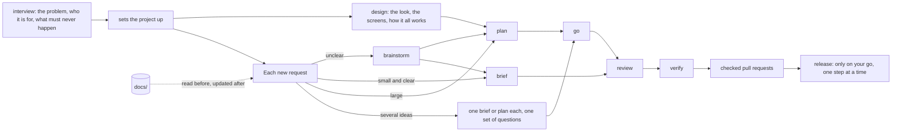
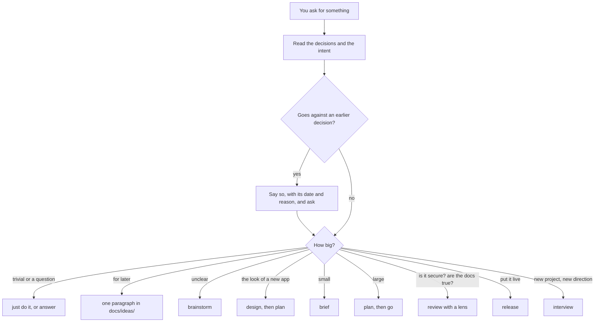
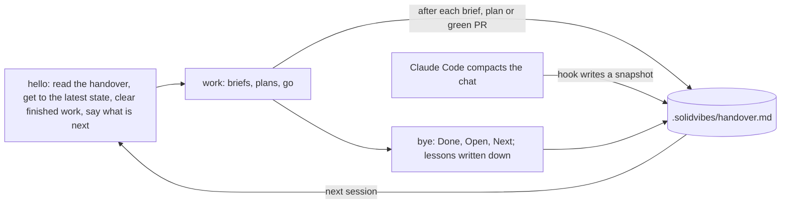
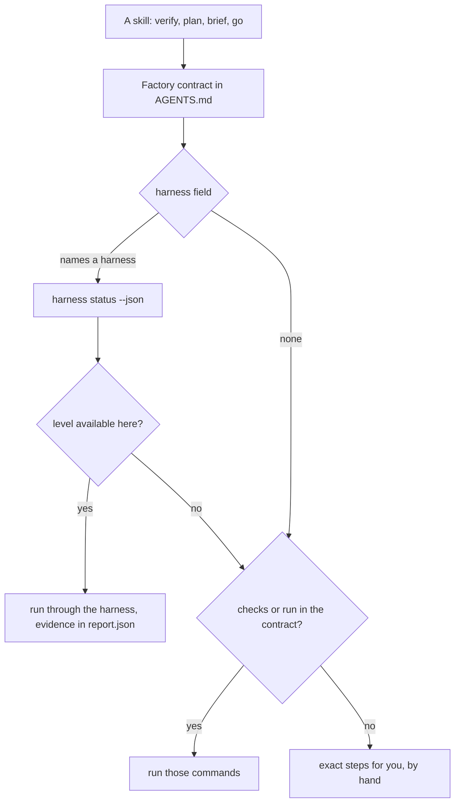

# Solid Vibes

**vibe coding that holds up**

Everybody's building now. They should be building better.

Solid Vibes is a setup for builders. Anyone can be a builder.

You talk to an AI in plain words. Solid Vibes makes it ask about the problem before it builds anything, write a plan you can read, check its own work with a fresh pair of eyes, and prove that the result runs. It works in Claude Code, Codex and other AI coding agents.

There is one product. It is the same for everyone. If you have never written code, you gain the most: you get the habits of a careful team without having to know them. If you are a developer, use it as it is, or swap the stack profile (see below) for your own choices.

## What it is



- **You talk.** No commands to learn.
- **`AGENTS.md`** is a file in your project. Solid Vibes writes it. It tells the AI how to handle every request: understand it, size it, pick the right step, say what happens next and wait for your go.
- **Skills** are the steps. Each one is a short instruction file the AI follows. There are twelve.
- **`docs/`** is your project's memory: why it exists, how it works, what was decided. The AI reads it first and keeps it true.

## Set it up

You need two things: a computer, and Claude Code (or Codex). Install Claude Code from [code.claude.com](https://code.claude.com/docs/en/overview) and sign in. Every step below is typed into Claude Code's chat box. If a step feels unfamiliar, tell the AI "do this for me" and it will explain what it is about to do first.

**1. Add Solid Vibes.** Type these two lines, one at a time:

```
/plugin marketplace add solidvibes/solid-vibes
/plugin install sv@solid-vibes
```

When it asks where to install, pick "Install for you" so it is there in every project.

**2. Keep it up to date.** Marketplaces from outside Anthropic do not update themselves unless you ask. Type `/plugin`, open the **Marketplaces** tab, pick `solid-vibes` and choose **Enable auto-update**. From then on new versions arrive on their own, and you will see a note when one lands.

**3. Start.** Open an empty folder in Claude Code and say what you want, for example:

> I'm a dentist and want my patients to book online.

Solid Vibes starts with a conversation about the problem, not a list of features. At the end the AI sets the project up (it will tell you what it does, including saving your work with git, which it handles for you).

**4. Codex and other agents.** Claude Code finds the `solidvibes` command by itself. For other agents, ask your AI: "put the `solidvibes` command on my PATH, then run `solidvibes install`". By hand, that is one line in your shell profile, with `<folder>` where you keep Solid Vibes:

```
export PATH="$PATH:<folder>/bin"
```

and then `solidvibes install`, which links every skill into `~/.agents/skills/` for Codex and other agents. It replaces only its own links and deletes nothing. Run `solidvibes install` again after every update, so new skills get linked; it also names links to skills that no longer exist, for you to remove.

## The skills

You call five by name: **interview**, **hello**, **bye**, **release** and **update**. The routing in `AGENTS.md` picks the other seven from what you say: **design**, **brainstorm**, **brief**, **plan**, **go**, **review** and **verify**.

| Skill | Who starts it | What it does |
|---|---|---|
| interview | you | A conversation about the problem, then sets the project up. Run it again when the direction changes. |
| hello | you, at the start of a session | Picks up where you stopped, brings the setup up to date, clears finished work, checks the project's health. |
| bye | you, at the end of a session | Writes down where things stand and keeps what was learned. |
| release | you | Merges, deploys, publishes. Every outward step waits for your go. |
| update | you, now and then | Brings the tools and every package to their latest, big upgrades included, asks only what needs your call, proves the app still builds and works and ends in a pull request. |
| design | routing, and setup of a new project | The look of a new app: three directions to pick from, then the design system, the screens and one picture of how it all works. |
| brainstorm | routing | Explores an unclear idea and the decisions that are hard to undo. |
| brief | routing | One small, clear change, from idea to checked result, without a plan file. Also "update the docs". |
| plan | routing | A written plan, split into phases you approve. |
| go | routing | Builds an approved plan, one fresh AI per phase, and stops at checked pull requests. |
| review | routing | A fresh reviewer reads the change, or looks at the whole project through a lens. |
| verify | routing | Proves the change does what was asked, cheapest check first. |

A thought for later goes into `docs/ideas/` as one paragraph. A question about how something works gets an answer from the code. Neither needs a skill.

## The method



1. **interview.** Five short rounds about the problem, who it is for, why it matters, what it must never do, the devices and when you want it, how it pays and how it gets built. After each round the AI shows in a small table what your answers mean for how the thing is built, and records each one you accept as a decision. It ends by setting the project up without asking about standard things: `AGENTS.md`, the `docs/` folder, the project's contract and any first rules. Safe to run again; it never deletes anything.
2. **design.** On a new project, setup goes straight into the look: three directions side by side, then colours, type and the core parts (built so everyone can read and tap them), then the main screens and their states, then one moving picture of how the whole thing works. One approval per step; then it plans the first version.
3. **brainstorm, brief, plan.** Unclear ideas get explored. Small changes get a short brief. Larger ones get a written plan split into phases that you approve; then you type `/clear` and say go, so the build starts fresh.
4. **go.** One fresh AI per phase writes the code. It stops at checked, reviewed pull requests.
5. **review.** A different AI, with no memory of writing the code, reads it like a careful colleague. In a tool that cannot start a second AI, the report says the review was not independent.
6. **verify.** Proves the change does what was asked, cheapest check first, and says plainly what could not be checked here.
7. **release.** Merges, deploys, publishes. Every outward step waits for your explicit go.

Every decision comes with a picture. How it is shown depends on the tool: Claude Code shows a page, Codex a local file, others a diagram in the chat.

### How a request is routed



Before anything else the AI reads what you decided earlier. If a request goes against a decision, it says so ("On 3 March you decided X, because Y") and asks whether to change it. A change is a new decision.

### Review lenses

`review` can look at one concern closely, on a change or on the whole project. It reports and changes nothing.

- **security**: ways the project could be abused, worst first. Runs before the first release and on changes to sign-in, payments or personal data. When the stack profile has security checklists, it works through them too.
- **docs**: what the docs say that the code no longer does.
- **speed**: what makes it slow for the people using it.
- **architecture**: whether the code keeps the shape the project chose.

## Sessions: hello and bye



- **hello** starts a session, kept light. It reads the handover, pulls in new commits, brings the project's setup up to date when Solid Vibes was updated, clears finished side copies of the project and runs the stack's own quick checks. It ends with a short brief: what needs you, what's next, and the parked ideas when nothing is. Upgrades, the CI check and the docs tidy-up are `update`'s job.
- **bye** ends a session. It writes `.solidvibes/handover.md` (Done, Open, Next) and writes this session's corrections and decisions where they belong.
- **The handover** is a file on your machine, never committed. In Claude Code two hooks help: before the chat is compacted, a snapshot of the branch and recent work is saved into it; when a session starts, it is printed. In Codex and other agents you type hello and bye.

### How knowledge compounds

Every session leaves the project a little easier to work on.

- **Decisions** go in `docs/decisions/`, one file each, with the date and why. The routing reads them first.
- **How it works** goes in `docs/how-it-works/`, kept true by `brief` and checked by the docs lens.
- **Rules** for one part of the code go in `.agents/skills/<topic>/`. Setup writes a few to start; corrections add to them.
- **Rules for everything** go in `AGENTS.md`.

`bye` writes down what was learned. `hello` keeps it small: it hashes the intent, decisions, how-it-works, rules and `AGENTS.md`, and tidies them only when the hash changed.

## The contract, in one screen

Every project says how it is built and checked in one section of `AGENTS.md`, called the Factory contract. The skills read it and never guess your stack. A short example:

```markdown
## Factory

- **layers** — screen → state → repository → local database
- **checks** — fast: `npm run lint` · full: `npm run lint && npm test`
- **codegen** — none
- **run** — `npm run dev`; screenshot with the browser's capture
- **plans** — `docs/plans/YYYY-MM-DD-<slug>.md`
- **docs** — behavior: `docs/how-it-works/` · changelog: `CHANGELOG.md`, one plain sentence
- **rules** — always-on: `AGENTS.md`
- **risk** — sign-in, payments, deleting people's data
- **ships** — web
- **sandbox** — none
- **stack** — `docs/stack.md`
- **harness** — none
```

`checks` says how to test, `run` how to see it, `risk` where a human must look. The AI drafts it with you in plain words when it sets the project up. `solidvibes doctor` reads it and tells you if anything is off.

## The seam: how proof works with and without a harness



Skills never ask whether a harness is installed. The contract says. With nothing declared they run your own `checks` and `run`; with neither, they give you exact steps to try it yourself, and never call something proven that was not.

## Stack profiles

Opinions about tools live in one place, a stack profile, copied into your project as `docs/stack.md`. A `blank` profile ships here: the AI fills in the choices with you and explains each in one plain sentence. A new stack is a new profile, and swapping a choice means editing one file. The format is in [docs/how-it-works/profile-format.md](docs/how-it-works/profile-format.md).

## The Flutter and Supabase extension (planned)

Solid Vibes is the method. The extension is a set of stack decisions, already made and packaged, for Claude Code with Flutter and Supabase, self-hosted on a VPS with Caddy:

- the decisions and rules for the stack (go_router, macOS navigation, the testing setup and more);
- a proof harness that drives simulators, a browser, a desktop app and database tests and writes the evidence;
- CI templates that run on pull requests only, filtered by path;
- Fastlane, store screenshots, signing and flavors;
- release steps, and the stack checks `hello` runs.

Planned, not released.

## The `solidvibes` command

- `solidvibes init [--profile <dir>] [--agents claude,codex,generic] <dir>` sets a project up, or brings it up to date. Never deletes.
- `solidvibes doctor [dir]` checks a project's setup and changes nothing.
- `solidvibes lint <dir>` checks skills and plugin files.
- `solidvibes worktrees [--clean] [path]` lists working copies and removes the finished ones.
- `solidvibes run <plan|"task"> [--agent claude|codex|"<cmd>"] [--dry-run]` hands work to an agent in its own sandboxed copy. [How it works](docs/how-it-works/headless-run.md).
- `solidvibes stop <slug>` stops a run.
- `solidvibes install [nono]` links the skills for Codex and other agents, or the sandbox profile. Deletes nothing.
- `solidvibes hello [--full] [--checked] [dir]` prints a project's status at the start of a session: handover, setup, CI, docs.
- `solidvibes update [dir]` prints where a repo stands for the `update` skill: branch drift, unsaved work, unreleased changes and every Flutter, Node and Supabase folder. [How it works](docs/how-it-works/update.md).
- `solidvibes handover --snapshot [dir]` saves the git snapshot into `.solidvibes/handover.md`. The Claude Code hook runs it before compaction.
- `solidvibes statusline --check|--install` reports or installs a two-line status bar for Claude Code: folder and branch, then model, memory used, cost and time, with a nudge to start fresh. Never replaces yours. [How it works](docs/how-it-works/status-bar.md).

More: [docs/how-it-works/](docs/how-it-works/) and [docs/decisions/](docs/decisions/).

Licensed MIT by Stojanov Ventures.
