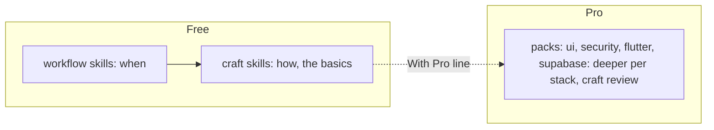

# Free craft skills for the basics; Pro goes deeper per stack

**Date:** 2026-10-30
**Who decided:** mine (the split and the five skills); agent's (where `brand` writes, the security and accessibility split between skill and lens, one routing line)

## Context

The free plugin had workflow skills only: when to do what. It said little about how to do one discipline well, so the basics of design, accessibility, security and words depended on the stack pack or on luck. The 2026-10-24 decision on skill names kept small concerns out of the skill list ("security is a review lens").

## Decision

The free plugin gains five **craft skills**, each about one discipline on any stack, the basics everyone should get right:

- `brand` — logo mark and wordmark as SVG, an app icon, and a brand board page.
- `design-system` — colours by job light and dark, type scale, spacing, corners, icons, core parts and their states. Step 2 of `design`, moved out and kept simple.
- `accessibility` — contrast, text that grows, screen reader labels, focus, motion, touch size, colour never alone, plain errors.
- `security` — who could be hurt, where secrets live, what personal data leaves the device, sign-in and payments.
- `writing` — the voice, plain words, true claims, buttons, errors and confirmations, docs, no AI tics.

`design` stays the orchestrator after the interview: direction → brand → design system → screens → system picture. Craft skills are routed, never called by name: other skills (`design`, `review`, `plan`, `brief`, `go`) load them when a change touches what they cover, and their descriptions catch requests made directly.

Pro (the separate `sv-pro` plugin) goes deeper per stack. The senior-designer craft review (hierarchy, alignment, density, restraint, consistency) is Pro only. Each craft skill ends with one "With Pro" line naming the pack that goes deeper.

Agent's calls:
- `brand` writes its own `docs/design/brand.md` plus `docs/design/brand/*.svg`, not an extended `direction.md`: one file per design step keeps `design`'s "resume at the first step not yet written" rule as it was.
- Security: the skill is for building, the review lens for checking. The basics are written once, in the skill; the lens reads them as its floor and goes deeper. Accessibility works the same way, with a short new lens.
- The routing template names the craft skills in one numbered line, not five table rows: most of the time they start inside another step.

## Why

Free should be good enough to start and show how much can be done; the in-depth checks are what Pro is for. Basics written once, in a skill named after the discipline, are easier to find and keep true than the same rules spread across `design`, `review` and the packs.

## Alternatives

More review lenses only (they check after the fact; nothing guides the build). Extending `design` with brand and accessibility steps (one long skill, and the rules unreachable from `brief`). Putting the craft review in free (nothing left that only Pro does well).

## What it means

Seventeen skills; this extends `2026-10-24-skill-names-are-public-api.md` (still five called by name) and narrows `2026-10-24-review-lenses.md`: a concern that guides building is a craft skill, one that only checks is a lens. "Make a design system" now routes to `design-system`. See `docs/how-it-works/craft-skills.md`.
