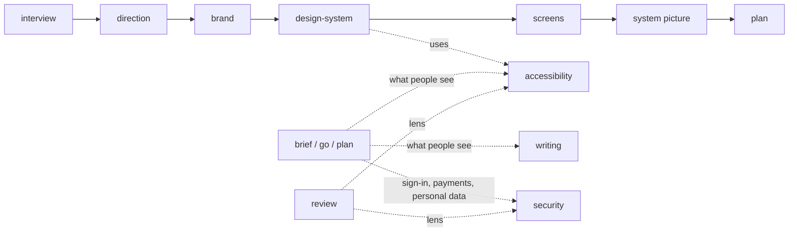

# Craft skills
**Date**: 2026-10-30
**Status**: Implemented
**Touches**: `docs/how-it-works/design.md`, `docs/how-it-works/craft-skills.md`, `skills/review/lenses/security.md`

## TL;DR
- Five new free skills: `brand`, `design-system`, `accessibility`, `security`, `writing`.
- Each says how to do one discipline well, on any stack: the basics everyone should get right.
- `design` stays the orchestrator: direction → brand → design system → screens → system picture.
- `design-system` is today's design Step 2, moved out; it writes `docs/design/system.md` in the same shape.
- `brand` writes `docs/design/brand.md` plus SVG files, and shows a brand board page.
- `accessibility` and `security` hold a `## The basics` list; review lenses check against it.
- Security: the skill is for building, the lens for reviewing; the lens reads the skill's basics as its floor.
- New `review/lenses/accessibility.md`: a thin lens over the accessibility skill's basics.
- `brief`, `go`, `plan`: one line each, loading the craft skills when a change touches what people see or sign-in, payments, personal data.
- The senior-designer craft review stays Pro only; each craft skill ends with one "With Pro" line.
- Routing template: one numbered line naming the craft skills; README table, CHANGELOG, a decision file.

## Context
The free plugin says when to do what, but not how to do one discipline well. Builders need the basics of design, accessibility, security and words on any stack. The owner decided the split on 2026-10-30: free has the basics, Pro goes deeper per stack.

## Constraints
- `AGENTS.md` (this repo): no owner data, plain language in what users read, descriptions are "Use when …" triggers in the user's phrases, only interview/release/hello/bye/update are called by name, every decision gets a visual.
- `solidvibes lint`: frontmatter name equals folder, description ≤ 1024 characters with "Use when", every "the `x` skill" exists.
- No risk area touched (`lib/cli-run.sh`, `profiles/solidvibes.json`, deletes, strip check, gitleaks allowlist).

## Approach

- Craft skills follow the existing shape: frontmatter, short intro, how you talk to the user, the contract, steps or a basics list, a Visuals section.
- `brand` writes its own file, `docs/design/brand.md`, with the SVGs in `docs/design/brand/`. One file per design step keeps `design`'s resume rule ("start at the first step not yet written") unchanged.
- Security split: the skill holds the basics to follow while building; the lens audits and reads the skill's basics as its floor, then goes deeper. The basics are written once, in the skill.
- Accessibility: the rules move from design Step 2 into the skill; `design-system` and the new lens point at them.
- Alternatives ruled out: extending `direction.md` with the brand (breaks the one-file-per-step resume rule); a security lens that copies the basics (two lists drift); a routing table row per craft skill (five more rows for work that mostly starts inside other skills).

## Files
- `skills/brand/SKILL.md` — new.
- `skills/design-system/SKILL.md` — new, from design Step 2.
- `skills/accessibility/SKILL.md` — new.
- `skills/security/SKILL.md` — new.
- `skills/writing/SKILL.md` — new.
- `skills/design/SKILL.md` — five steps, calls the craft skills.
- `skills/review/SKILL.md` — accessibility lens row.
- `skills/review/lenses/accessibility.md` — new, thin.
- `skills/review/lenses/security.md` — reads the security skill's basics first.
- `skills/brief/SKILL.md`, `skills/go/SKILL.md`, `skills/plan/SKILL.md` — one line each.
- `setup/templates/AGENTS.md` — routing step naming the craft skills.
- `setup/templates/docs/CONVENTIONS.md` — `design/` row adds `brand.md`.
- `docs/decisions/2026-10-30-craft-skills.md` — the owner's decision.
- `docs/how-it-works/craft-skills.md` — new; `docs/how-it-works/design.md` — five steps.
- `README.md`, `CHANGELOG.md`.

## Steps
- [x] Write the five craft skills.
- [x] Slim `design` to the orchestrator.
- [x] Wire `review`, the lenses, `brief`, `go`, `plan`.
- [x] Update the routing and conventions templates.
- [x] Decision, how-it-works, README, CHANGELOG.
- [x] Run the full checks and commit.

## Decisions
- Free gets basics on any stack; Pro goes deeper per stack; the senior-designer craft review is Pro only. **mine**
- The five skill names and their scope. **mine**
- `brand` writes `docs/design/brand.md`, not an extended `direction.md`. **agent's**
- Security: skill for building, lens for reviewing, the basics written once in the skill. **agent's**
- Accessibility gets a thin review lens over the skill's basics. **agent's**
- Craft skills are named in one routing step, not five table rows. **agent's**
- `make a design system` moves from `design`'s triggers to `design-system`. **agent's**

## Verification
- Full checks from `AGENTS.md` `## Factory`: syntax, `solidvibes lint .`, `scripts/strip-check.sh --history`, `tests/run.sh`, `claude plugin validate .`.
- Owner-checked: a design run in Claude Code shows the brand board and writes `brand.md`.

## Rule gaps
None.
